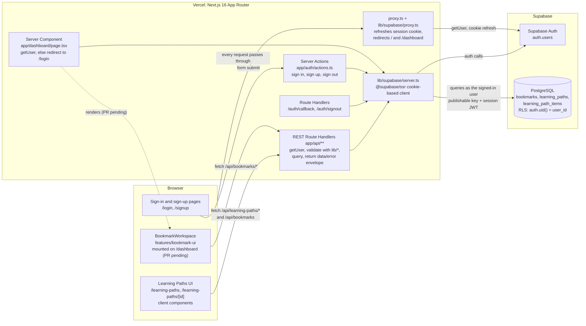
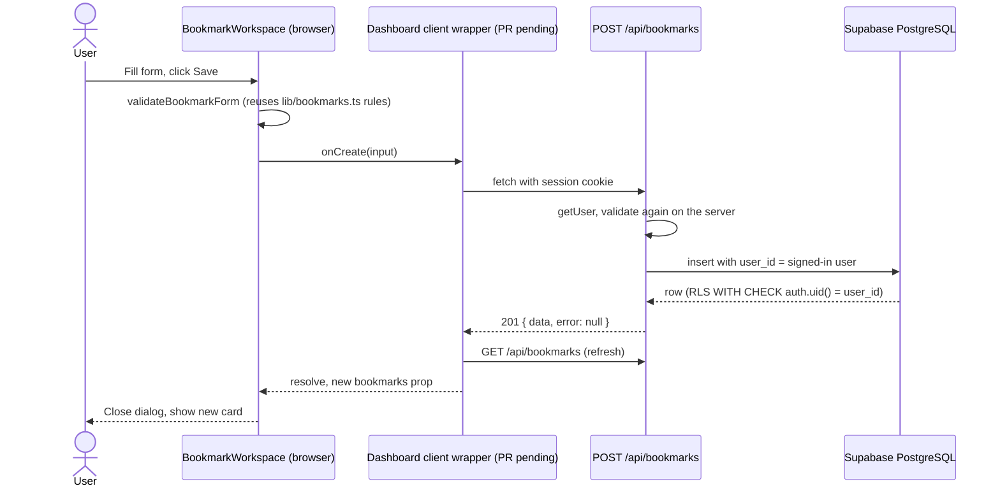
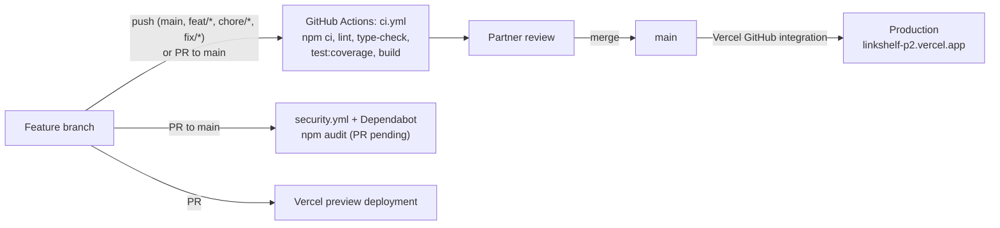
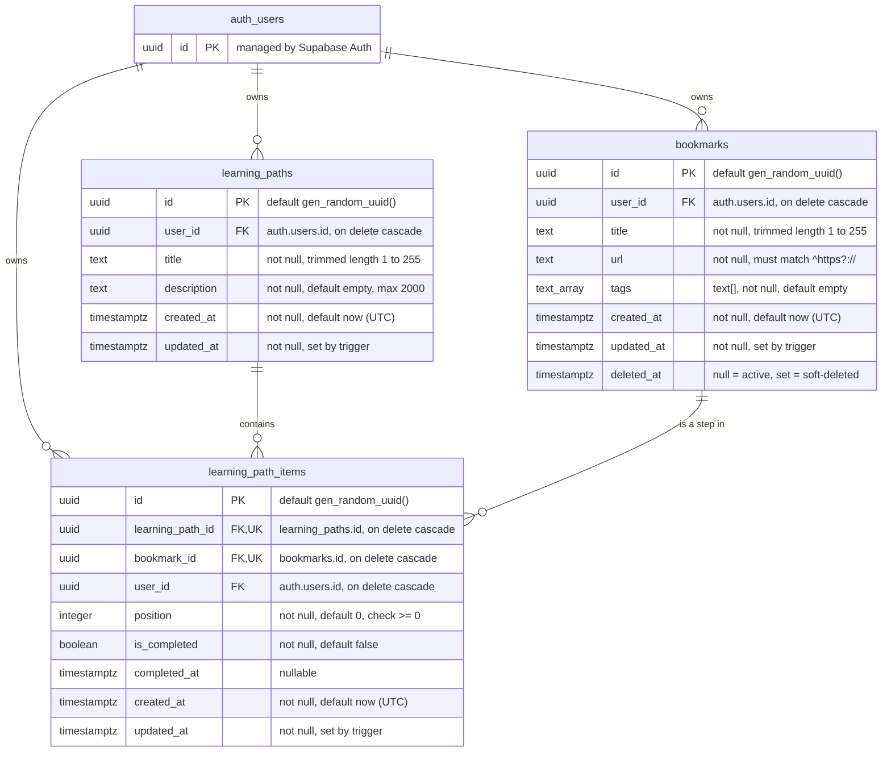

# LinkShelf — Architecture and Database Schema

This document describes the system as it exists in the repository. Every box, arrow, table, and column below was checked against the code on `main` (sources listed in §5). Parts that are still in open pull requests are labelled **(PR pending)**.

## 1. System architecture

### 1.1 Request flows

- **Every request** (except static assets) passes through `proxy.ts`, which calls `updateSession` in `lib/supabase/proxy.ts`. It verifies the user with `supabase.auth.getUser()`, refreshes session cookies, sends signed-out visitors on `/` or `/dashboard` to `/login`, and sends signed-in visitors on `/login`, `/signup`, or `/` to `/dashboard`. If the Supabase environment variables are missing, it passes requests through.
- **Authentication** never goes through `/api`. The sign-in and sign-up pages submit to Server Actions in `app/auth/actions.ts`, which validate input with `lib/auth.ts` and call `signInWithPassword`, `signUp`, or `signOut`. Email confirmation links land on `/auth/callback`, which calls `exchangeCodeForSession`.
- **Data** goes through the REST Route Handlers in `app/api/**`. Each handler creates the cookie-based server client, rejects requests without a user (401), validates input with `lib/bookmarks.ts` or `lib/learning-paths.ts`, runs the query, and returns the `{ data, error }` envelope from `lib/api-response.ts`. The Learning Paths pages and (after PR #16) the bookmark dashboard are client components that call these routes with `fetch`.
- **Authorization** is enforced twice: handlers filter by `user.id`, and PostgreSQL Row Level Security restricts every table to `auth.uid() = user_id` (§4.3). The server uses only the publishable key; no service-role key exists in the app.
- **Session transport** is cookies only. The server reads the session from cookies through `@supabase/ssr`; no route reads an `Authorization: Bearer` header.

### 1.2 Bookmark operation example

If any step fails, the wrapper throws, `onCreate` rejects, and the workspace keeps the dialog open with an error message.

## 2. CI/CD and deployment

- `ci.yml` builds with placeholder Supabase variables, so CI never needs real secrets.
- Playwright E2E tests (`e2e/`) are not part of `ci.yml`; they run locally with `npm run test:e2e` against `npm run start` on port 3001 and need test-account credentials.
- GitHub Actions runs are currently blocked by a billing lock on the repository owner's account; checks have been run locally instead.

## 3. Database ERD

`auth.users` is Supabase's built-in table (shown as `auth_users` because Mermaid entity names cannot contain dots). Only its `id` is referenced by this project, so no other columns are shown.

### 3.1 Relationships and constraints

| Relationship / constraint | Definition | Effect |
|---|---|---|
| `bookmarks.user_id → auth.users.id` | FK, `ON DELETE CASCADE` | A user's bookmarks are removed if the auth user is deleted. |
| `learning_paths.user_id → auth.users.id` | FK, `ON DELETE CASCADE` | Same for learning paths. |
| `learning_path_items.learning_path_id → learning_paths.id` | FK, `ON DELETE CASCADE` | Deleting a path deletes its items but not the bookmarks. |
| `learning_path_items.bookmark_id → bookmarks.id` | FK, `ON DELETE CASCADE` | Only applies to physical deletes; clients can only soft-delete bookmarks. |
| `learning_path_items.user_id → auth.users.id` | FK, `ON DELETE CASCADE` | Stored on each item so RLS can check ownership directly. |
| `learning_path_items_unique_bookmark` | `UNIQUE (learning_path_id, bookmark_id)` | A bookmark appears at most once per path (API returns 409). |
| `bookmarks_title_not_empty`, `bookmarks_title_max_length` | `CHECK` | Title is 1–255 characters after trimming. |
| `bookmarks_url_valid_protocol` | `CHECK (url ~* '^https?://')` | Rejects `javascript:`, `data:`, and other schemes at the database level. |
| `learning_paths_*` checks | `CHECK` | Title 1–255 characters; description at most 2000. |
| `learning_path_items_position_non_negative` | `CHECK (position >= 0)` | Positions are 0-based. |

### 3.2 Indexes and triggers

| Table | Indexes | Trigger |
|---|---|---|
| `bookmarks` | `user_id`; `(user_id, created_at DESC) WHERE deleted_at IS NULL`; `(user_id, deleted_at) WHERE deleted_at IS NOT NULL`; GIN on `tags`; `(user_id, lower(title))` | `set_updated_at` before update |
| `learning_paths` | `user_id`; `(user_id, created_at DESC)` | `set_updated_at` before update |
| `learning_path_items` | `(learning_path_id, position)`; `bookmark_id`; `user_id` | `set_updated_at` before update |

## 4. Access control

### 4.1 Table privileges for the `authenticated` role (final state after migration 002)

| Table | SELECT | INSERT | UPDATE | DELETE |
|---|---|---|---|---|
| `bookmarks` | yes | yes | yes (all columns) | **no**: soft delete via `deleted_at` only |
| `learning_paths` | yes | yes | `title`, `description` only | yes |
| `learning_path_items` | yes | yes | `position`, `is_completed`, `completed_at` only | yes |

All privileges are revoked from `anon`.

### 4.2 Soft delete

Single delete (`DELETE /api/bookmarks/[id]`) and bulk delete both set `deleted_at`; bulk restore sets it back to `NULL`, which powers Undo. Because the `authenticated` role has no `DELETE` privilege on `bookmarks`, physical deletion is impossible from the app.

### 4.3 Row Level Security policies

| Table | Policy checks |
|---|---|
| `bookmarks` | SELECT, INSERT, UPDATE: `auth.uid() = user_id` (UPDATE also in `WITH CHECK`, so ownership can't be transferred). No DELETE policy. |
| `learning_paths` | SELECT, INSERT, UPDATE, DELETE: `auth.uid() = user_id`. |
| `learning_path_items` | SELECT, DELETE: `auth.uid() = user_id`. INSERT: the caller owns the item, the target path, and the bookmark, and the bookmark is not soft-deleted. UPDATE: the caller still owns the item, path, and bookmark; soft-deleted bookmarks are allowed so completion can still be toggled. |

## 5. Sources checked

- `supabase/migrations/001_create_bookmarks.sql`, `supabase/migrations/002_create_learning_paths.sql`
- `proxy.ts`, `lib/supabase/proxy.ts`, `lib/supabase/server.ts`
- `app/auth/actions.ts`, `app/auth/callback/route.ts`, `app/auth/signout/route.ts`
- `app/dashboard/page.tsx`, `app/learning-paths/page.tsx`, `app/learning-paths/[id]/page.tsx`, `app/api/bookmarks/[id]/route.ts`
- `.github/workflows/ci.yml`, `playwright.config.ts`
- Open PRs referenced: #16 (dashboard integration), #18 (security scanning)

Not covered here: Vercel and Supabase dashboard settings, which live outside the repository (see `docs/DEPLOYMENT.md`).
